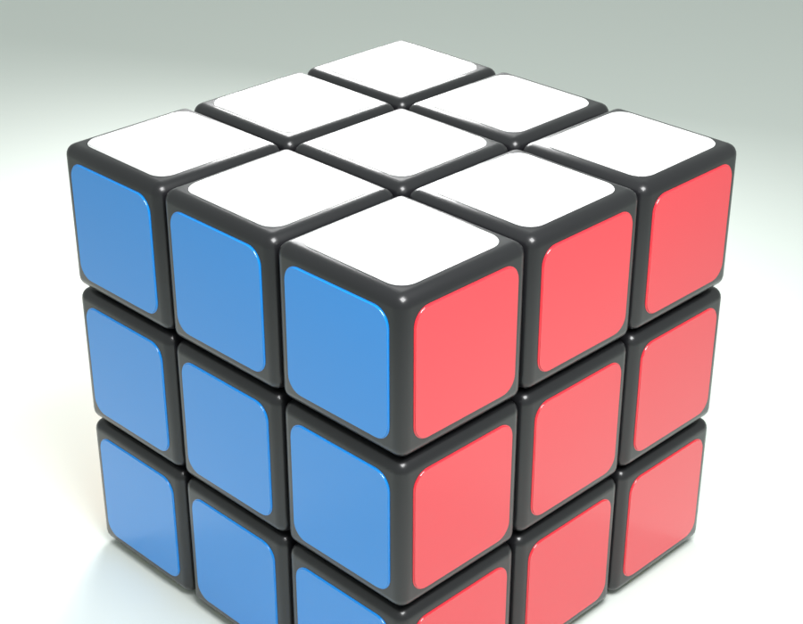

<div align="center">


# Rubik Academy

**Learn to solve the Rubik’s cube by watching every turn in 3D.**

A bilingual (Vietnamese / English) web app with a walk-around 3D showroom, a free-play cube, step-by-step lessons from beginner to CFOP, a full algorithm library, a competition-style timer, a trainer and an on-device camera scanner.

[](https://phucnguyen020611.github.io/rubik-academy/)
[](https://github.com/phucnguyen020611/rubik-academy/actions/workflows/deploy.yml)


**[Open the live site →](https://phucnguyen020611.github.io/rubik-academy/)**



</div>

---

## Table of contents

- [Features](#features)
- [Tech stack](#tech-stack)
- [Getting started](#getting-started)
- [Scripts](#scripts)
- [Project structure](#project-structure)
- [How it works](#how-it-works)
- [Deployment](#deployment)
- [Contributors](#contributors)

## Features

| | |
| --- | --- |
| **3D showroom** | The landing page is a room with four walls you can turn between: a shelf of 2×2 to 5×5 cubes flanked by a Megaminx, Pyraminx, Skewb, Square-1, Mirror cube and Clock, a study corner, a free-play pedestal and a practice desk with a detailed speed-stack timer. Cubes assemble themselves piece by piece as you arrive. |
| **Free play** | Drag on the cube to turn layers, drag outside to orbit. Move pad for U, R, F, M, x, r and friends, keyboard shortcuts, scramble, undo, solve timer, algorithm runner and a one-click solver for 3×3. |
| **Lessons** | Notation, an 8-step beginner method, 2-Look OLL/PLL, CFOP and Roux. Every step has a 3D player you can step through, slow down and orbit; pieces that do not matter yet are greyed out. |
| **Algorithm library** | All 41 F2L, 57 OLL and 21 PLL cases with filters, search, alternatives and “learned” tracking. Every diagram is generated from its own algorithm, so pictures and moves always agree. |
| **Cubing iceberg** | 30 techniques from Cross to ZBLL, explained in plain language, many with a 3D demo. |
| **Timer** | Hold-and-release timing, optional 15 s inspection with +2/DNF, Ao5, Ao12, mean, CSV export. |
| **Trainer** | Recognition and recall drills for PLL, OLL, 2-Look and F2L with random AUF; cases you miss come back more often. |
| **Camera scanner** | Show the six faces to your camera and the app reads the colours, checks the cube is solvable, lets you fix any sticker and shows a solution on a 3D copy of *your* cube. Everything runs on your device; no images leave the browser. |
| **About** | The story behind the project: two brothers who love the cube, and why the site was built. |
| **Polish** | Light and dark themes in a four-leaf-clover palette, Vietnamese and English, a hand-built UI kit, responsive down to 360 px. |

## Tech stack

| Area | Tools |
| --- | --- |
| App | [React 19](https://react.dev), [TypeScript](https://www.typescriptlang.org), [Vite](https://vite.dev), [React Router](https://reactrouter.com) |
| 3D | [Three.js](https://threejs.org), [React Three Fiber](https://r3f.docs.pmnd.rs), [drei](https://drei.docs.pmnd.rs), [postprocessing](https://github.com/pmndrs/react-postprocessing) (ambient occlusion, bloom) |
| Models | [Blender](https://www.blender.org) (scripted with Python, exported as glTF) |
| Solver | [cubejs](https://github.com/ldez/cubejs) (Kociemba two-phase) running in a Web Worker |
| UI | Custom components and CSS, [Lucide](https://lucide.dev) icons, Bricolage Grotesque and Plus Jakarta Sans |
| Hosting | GitHub Pages, deployed by GitHub Actions |

## Getting started

Requires **Node.js 20+** (24 recommended).

```bash
git clone https://github.com/phucnguyen020611/rubik-academy.git
cd rubik-academy
npm install
npm run dev
```

Then open <http://localhost:5173>. The camera scanner needs `localhost` or HTTPS to access the camera.

## Scripts

| Command | What it does |
| --- | --- |
| `npm run dev` | Start the dev server with hot reload |
| `npm run build` | Type-check and build to `dist/` (served under `/rubik-academy/`) |
| `npm run preview` | Serve the production build locally |
| `npm run verify` | Run the correctness checks: cube engine, every OLL/PLL/F2L case, beginner demos, solver round-trips and the scanner pipeline |
| `npm run lint` | Lint the code |
| `npm run models` | Rebuild the 3D models from `blender/build_models.py` (needs Blender installed; edit the path in `package.json` if yours differs) |

## Project structure

```
├── blender/            Python script that builds the cubie, trophy and plant models
├── public/models/      Exported glTF models (detailed and lightweight cubie)
├── scripts/            Verification scripts and the F2L algorithm generator
└── src/
    ├── cube/           Cube engine, instanced 3D cube, algorithm player, diagrams, solver, scanner
    ├── data/           OLL, PLL, F2L, beginner lessons, iceberg and patterns (bilingual)
    ├── showroom/       The 3D landing room and its procedural textures
    ├── pages/          One file per route
    ├── components/     Navigation, footer and shared page pieces
    ├── ui/             Button, Select, Checkbox, Switch, Slider, Modal, Drawer, Toast, logo, flags
    └── i18n.tsx        Vietnamese / English strings
```

## How it works

- **Engine.** A small NxN model stores each piece’s position and orientation as integer matrices, parses standard notation (wide moves, slices, rotations, repeats) and converts to the 54-sticker format the solver uses.
- **Rendering.** Each cube is two instanced meshes (bodies and stickers), so a 5×5 costs two draw calls. The showroom uses one moving shadow-casting light, renders at the screen’s pixel density and pauses when scrolled out of view.
- **Generated content.** Case diagrams are computed by applying the inverse of each algorithm to a solved cube. The 41 F2L algorithms were found by an exhaustive search over insert triggers and verified to keep the cross and other slots intact.
- **Scanner.** Sticker colours are sampled with glare and shadow rejection, compared in OKLab, and split into six groups of exactly nine using the centres as anchors (Hungarian assignment). A validity check catches impossible corners and edges, twists, flips and parity before solving.

## Deployment

Every push to `main` runs [`.github/workflows/deploy.yml`](.github/workflows/deploy.yml), which builds the site and publishes `dist/` to the `gh-pages` branch. GitHub Pages serves that branch at <https://phucnguyen020611.github.io/rubik-academy/>.

## Contributors

<table>
  <tr>
    <td align="center">
      <a href="https://github.com/phucnguyen020611">
        <br />
        <sub><b>Phuc Nguyen Hoang</b></sub>
      </a><br />
      <sub>Design & development</sub>
    </td>
  </tr>
</table>

---

<div align="center">
<sub>Rubik’s Cube is a trademark of its respective owner. This project is not affiliated with it.</sub>
</div>
